# Google Cloud Static Website Proof of Concept

## Watch the build

Video not recorded yet. The thumbnail and the link go here after the recording.

<!-- [](LOOM_LINK) -->

**Live site:** not created yet. The address will be `http://<bucket-name>.storage.googleapis.com/`. **Author:** Zeon Stewart, [LinkedIn](LINKEDIN_LINK_HERE)

## At a glance

- **What it is:** a website that runs directly from Google Cloud Storage, with no server to rent, patch, or keep running.
- **Business problem:** a small business needs a public website that is fast, cheap, and has nothing to maintain.
- **What's automated:** three scripts create the project and the bucket, upload the pages, check the public address, and delete the project again.
- **Why it's secure:** no key file is stored in this repository. Visitors can read the pages. They cannot change the bucket.
- **Result:** not proven yet. The checks below stay open until `scripts/verify.sh` prints zero failures.

Part of [Cloud Projects](https://github.com/zsociety47/cloud-projects). Technical details are in [Technical findings](#technical-findings) at the bottom.

---

## Project Steps

These steps build the site by hand in the [Google Cloud console](https://console.cloud.google.com). Doing it by hand once shows what each piece is. The [automated setup](#automated-setup) then does the same thing with scripts. Each step names the script line that automates it.

Copy `.env.example` to `.env` first and pick a project id and a bucket name. Both have to be unique across Google Cloud, not just in your account. Use those names wherever this page says `<project-id>` and `<bucket-name>`.

The website address is HTTP (Hypertext Transfer Protocol) only. It is not HTTPS (Hypertext Transfer Protocol Secure). That is a limit of bucket website hosting, not a missed setting. Putting HTTPS in front of the bucket needs a load balancer, which costs money while it sits idle, so this proof does not do that.

Screenshots are not taken yet. Each image line stays commented out until the file exists. The shot list is in the private notes.

### Step 1: Create a project

*Automated by `gcloud projects create` in `scripts/deploy.sh`.*

1. Open the project picker and select **New project**.
2. **Project name:** `static website poc`
3. **Project ID:** `<project-id>` (the value of `GCP_PROJECT_ID` in `.env`)
4. Select **Create**.
5. Add these four labels. A label value cannot contain a colon, so the time uses hyphens: `2026-10-26t17-30-00z`.
   - `lifetime` = `1d`
   - `owner` = `zeon`
   - `project` = `gcp-static-website-poc`
   - `created` = the time you created it, in that hyphen form

<!-- 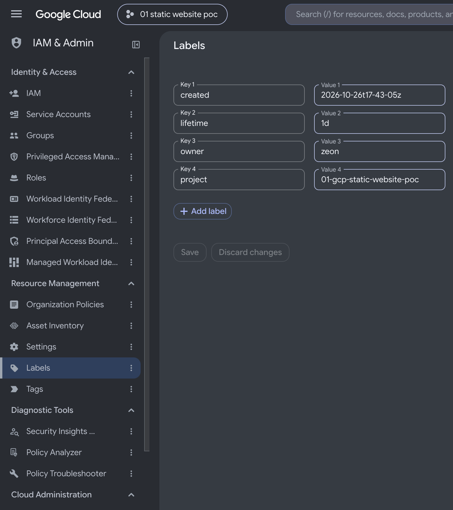 -->

### Step 2: Link billing

*Automated by `gcloud billing projects link` in `scripts/deploy.sh`.*

Cloud Storage will not turn on until a billing account is linked. Linking it makes charges possible if usage leaves the free tier. A site this size, in `us-east1`, should stay at $0.

1. Open **Billing** and link your billing account to `<project-id>`.
2. Do not copy the billing account id into the repository, a screenshot, or a commit.

<!-- 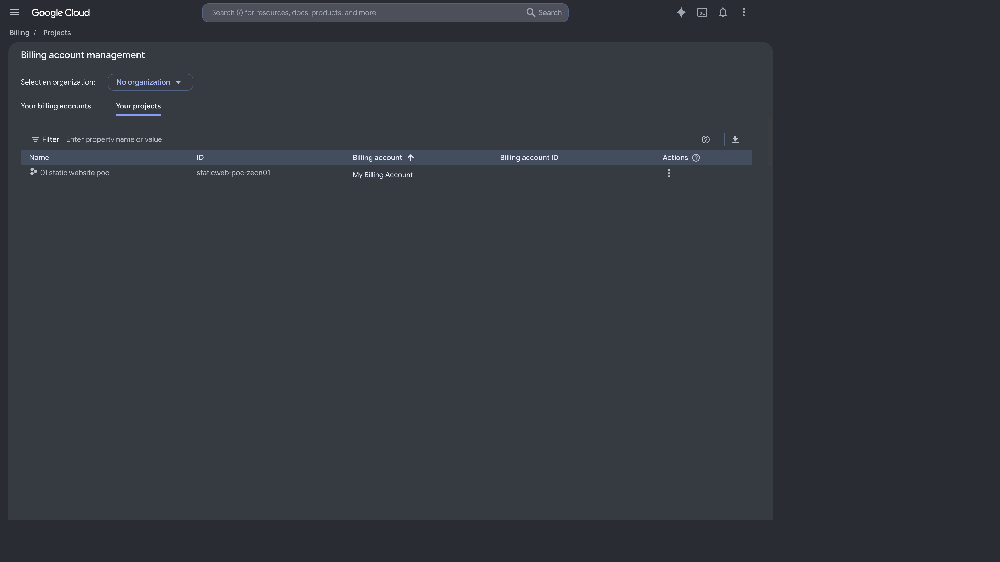 -->

### Step 3: Create the bucket

*Automated by `gcloud storage buckets create` in `scripts/deploy.sh`.*

1. Search for **Cloud Storage** and select **Buckets**, then **Create**.
2. **Name:** `<bucket-name>`
3. **Location:** `us-east1` (Region). This region is in the Cloud Storage free tier. `us-east4` is not.
4. **Storage class:** Standard
5. **Access control:** Uniform. This means one identity and access management (IAM) policy for the whole bucket, not a separate list on each file.
6. **Public access prevention:** off. The site has to be readable by people who are not signed in.
7. **Soft delete:** off (duration 0). Deleted files are not kept, so they cannot add a storage charge.
8. Add the same four labels as the project.

<!-- 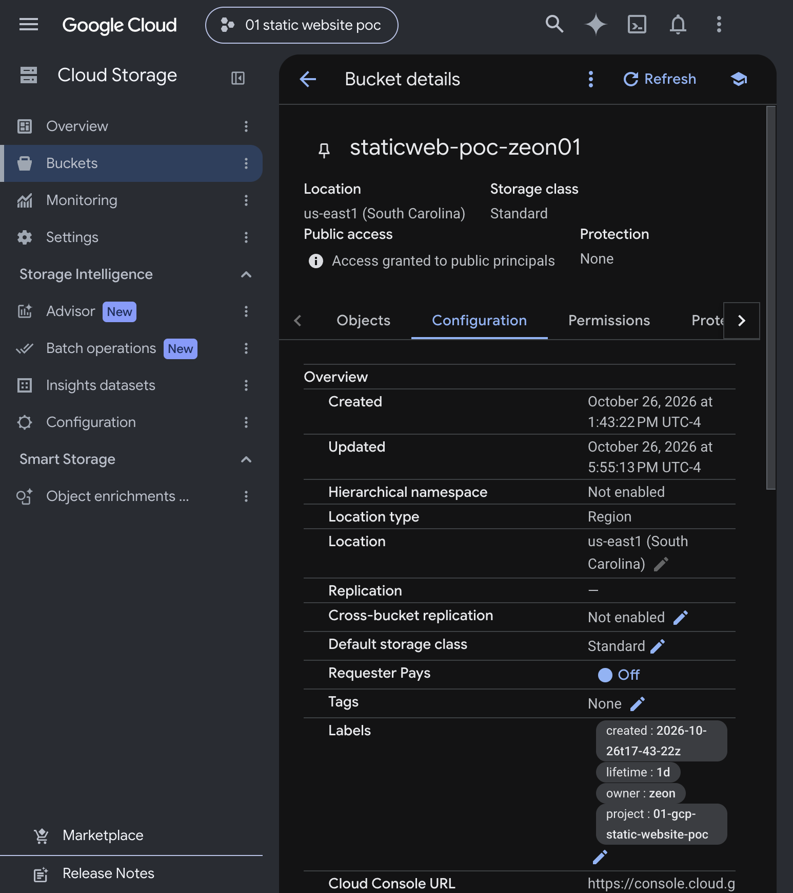 -->

### Step 4: Set the index page and the missing-page file

*Automated by `gcloud storage buckets update --web-main-page-suffix --web-error-page` in `scripts/deploy.sh`.*

1. Open the bucket and find **Website configuration**.
2. **Index page:** `index.html`
3. **Error page:** `404.html`
4. Save.

<!-- 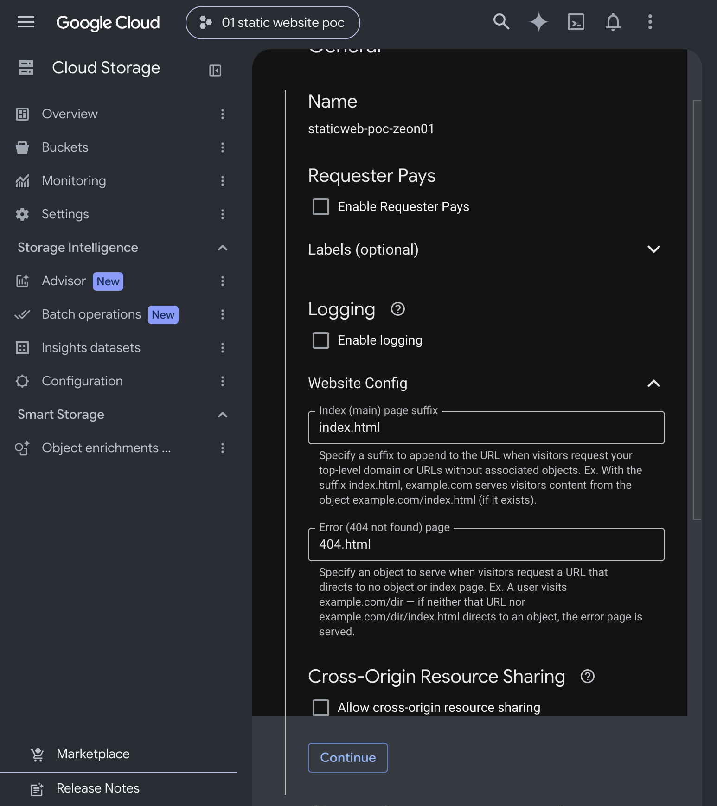 -->

### Step 5: Let anyone read the objects

*Automated by `gcloud storage buckets add-iam-policy-binding` in `scripts/deploy.sh`.*

1. Open the bucket's **Permissions** tab and select **Grant access**.
2. **Principal:** `allUsers`
3. **Role:** Storage Object Viewer (`roles/storage.objectViewer`)
4. Confirm the public-access warning.

This role lets a visitor open a file. It also lets a visitor list the file names in the bucket. The Azure site does not list names from its website address. That difference is recorded in [Google Cloud and Azure](#google-cloud-and-azure).

<!-- 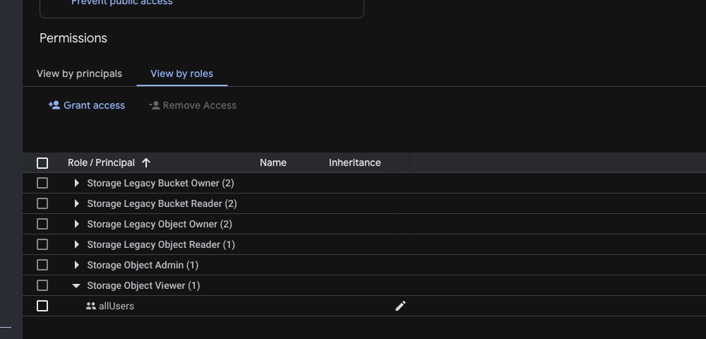 -->

### Step 6: Upload the site files

*Automated by `gcloud storage rsync --delete-unmatched-destination-objects` in `scripts/deploy.sh`.*

1. Open the bucket's **Objects** tab and upload the files in `site/`.
2. `index.html` and `404.html` have to be at the top of the bucket, not inside a folder.

The script also deletes a cloud file when that file is gone from `site/`. A plain upload does not.

<!-- 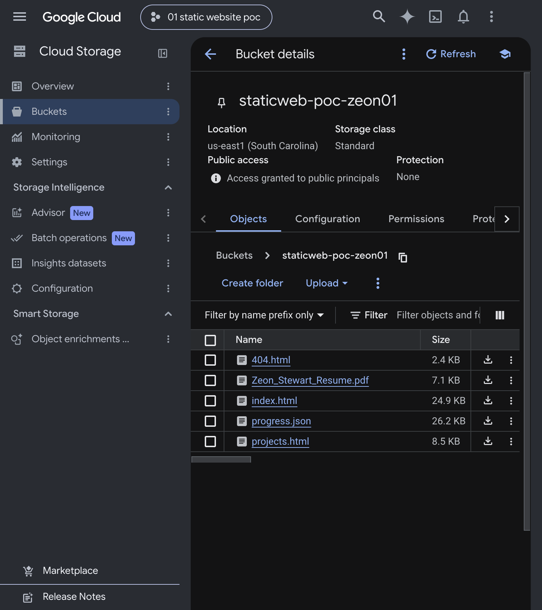 -->

### Step 7: Open the site

1. Open `http://<bucket-name>.storage.googleapis.com/`. The home page loads. The address bar says HTTP, not HTTPS.
2. Add `does-not-exist` to the end of the address. The custom 404 page loads.

<!-- 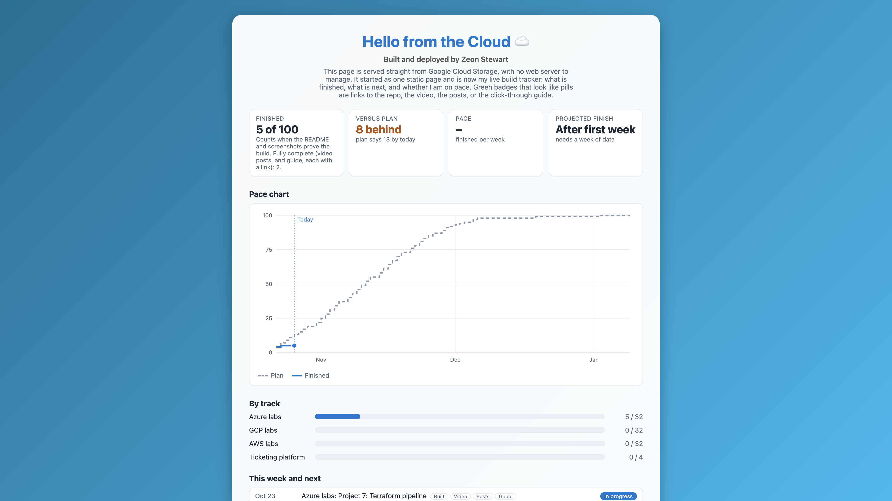 -->
<!-- 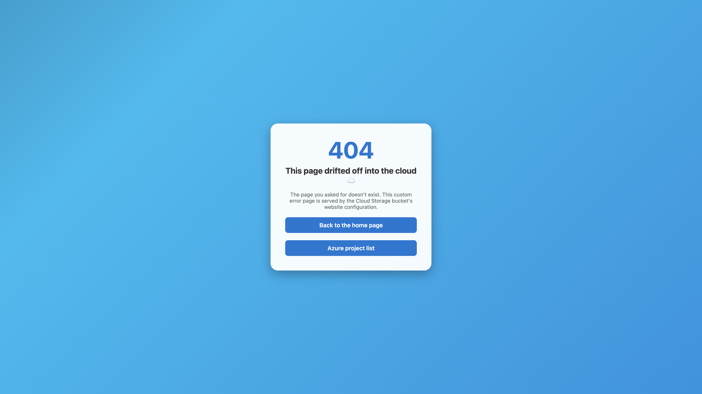 -->

### Step 8: Run the check

*This is `scripts/verify.sh`.*

```bash
./scripts/verify.sh
```

The last line should be `14 passed, 0 failed`.

<!-- 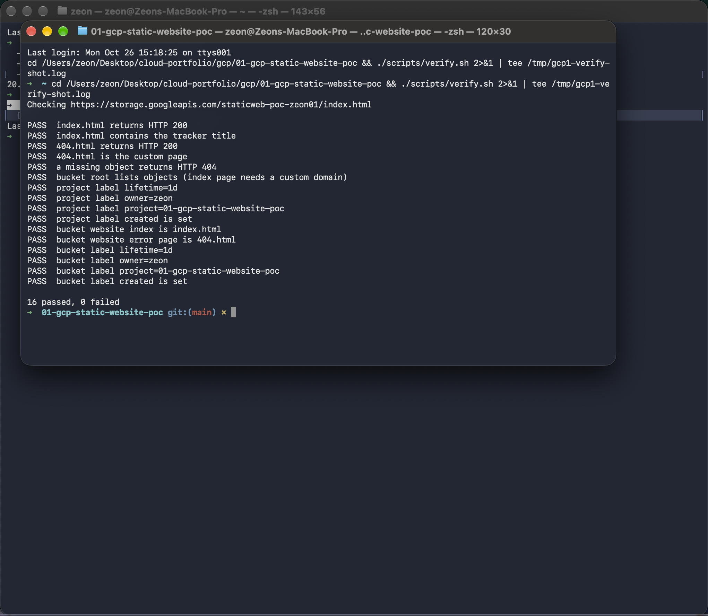 -->

### Step 9: Clean up when you're done

```bash
./scripts/teardown.sh
```

Type the project id when it asks. That deletes the bucket and the project. Nothing is deleted if the name you type does not match.

The nightly sweep is a different file, `cloud-projects/environment-control/envctl-gcp.sh`. It deletes Google Cloud projects labeled `lifetime=1d` that are at least an hour old. It does not ask you to type the name. This project's teardown script is the one that asks.

A deleted project id cannot be reused until Google finishes the delete, which can take 30 days. Pick a new `GCP_PROJECT_ID` in `.env` for the next build.

<!-- 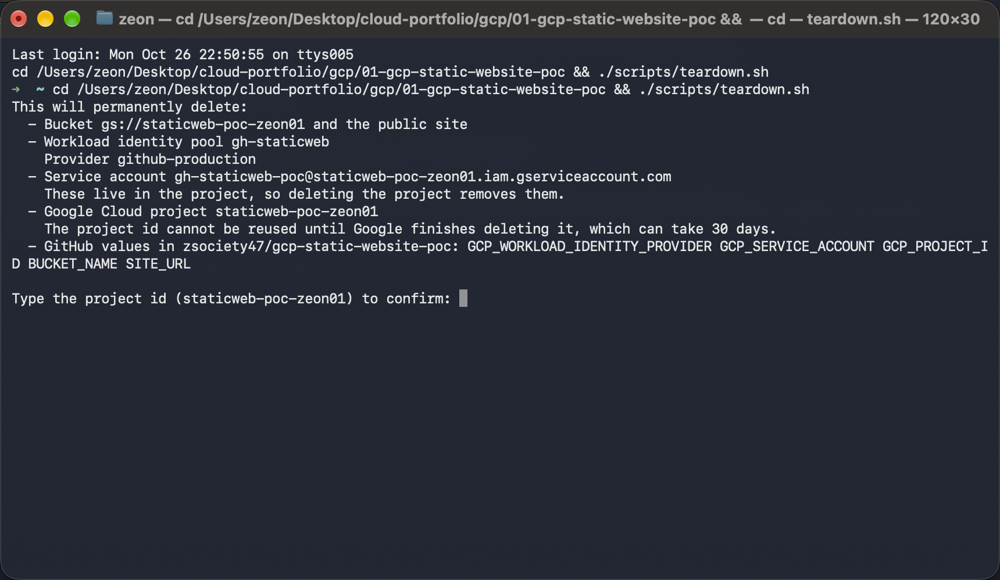 -->

### Screenshots still to take

- `docs/images/step-01-project.png`
- `docs/images/step-02-billing.png` (crop the billing account id)
- `docs/images/step-03-bucket.png`
- `docs/images/step-04-website.png`
- `docs/images/step-05-public-read.png`
- `docs/images/step-06-upload.png`
- `docs/images/step-07-live-site.png`
- `docs/images/step-07-404.png`
- `docs/images/step-08-verify.png`
- `docs/images/step-09-teardown.png`

---

## Automated setup

The same build as the Project Steps. Nothing here creates a resource until you run `deploy.sh`.

**Prerequisites:** the Google Cloud command-line interface (CLI), signed in with `gcloud auth login`, and a billing account you are allowed to link. `curl` is used by the check.

**1. Save the names locally**

```bash
cp .env.example .env
```

Fill in `GCP_BILLING_ACCOUNT`. Leave the other three values unless the project id or the bucket name is already taken. Do not commit `.env`.

**2. Create the project, the bucket, and the site** (steps 1-7)

```bash
./scripts/deploy.sh
```

The script prints the site address. Re-running it reuses the project only if that project already has this proof's labels.

**3. Check it** (step 8)

```bash
./scripts/verify.sh
```

**4. Tear it down** (step 9)

```bash
./scripts/teardown.sh
```

---

## Architecture

The design picture is not drawn yet. When this build is finished, redraw it on the design canvas and export `docs/architecture/architecture.png` and `docs/architecture/architecture.pdf`. That picture is the reference. The diagram below is the live map, and it changes with the scripts.

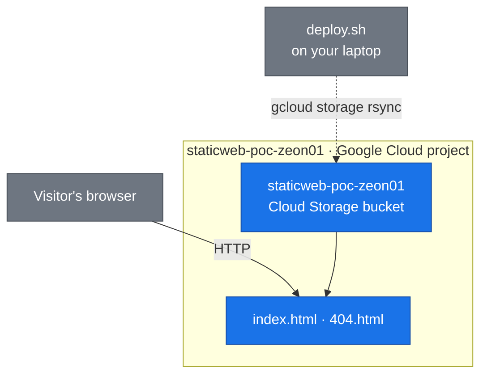

**How to read this diagram**

- **Solid arrow:** how a visitor reaches the site.
- **Dashed arrow:** how the files get there.
- **Blue:** Google Cloud resources. The shared diagram standard uses Azure blue for Azure resources. This cloud uses Google blue (`#1a73e8`) for its own resources. **Gray:** outside the cloud (the visitor and the laptop).

*A visitor reads the pages over HTTP from the bucket's website address. `deploy.sh` uploads `site/` with the signed-in gcloud user. There is no key file in the repository.*

The names in the diagram are the examples in `.env.example`. If you change `.env`, change this diagram in the same commit.

*Diagram follows the [shared diagram standard](https://github.com/zsociety47/cloud-projects/blob/main/standards/DIAGRAM-STANDARD.md), with the resource color changed for this cloud.*

---

## Google Cloud and Azure

Same idea, different names. The Azure proof is [azure-static-website-poc](https://github.com/zsociety47/azure-static-website-poc).

| Idea | Azure | Google Cloud |
|---|---|---|
| Where the files live | Storage account `ststaticwebpoczeon01` | Bucket `staticweb-poc-zeon01` |
| What groups the resources | Resource group `rg-staticweb-poc-zeon01` | Project `<project-id>`. Deleting the project deletes what is inside it |
| How the site is turned on | Static website on the `$web` container | Website configuration: index suffix and error page |
| Public address | `https://<account>.z13.web.core.windows.net` | `http://<bucket>.storage.googleapis.com` |
| HTTPS on that address | Yes, by default | No. HTTPS needs a load balancer in front, which this proof does not create |
| Who can read | The website endpoint serves the pages. Anonymous listing of the container stays off | `allUsers` with Storage Object Viewer. That role can also list object names |
| Who can upload | Storage Blob Data Contributor, separate from Owner | The signed-in user who owns the project. No separate data role was required to upload |
| Upload command | `az storage blob upload-batch` adds and overwrites. A deleted page stays live | `gcloud storage rsync --delete-unmatched-destination-objects` removes a cloud file when the local file is gone |
| Marks for cleanup | Tags. `created` can contain a colon | Labels. `created` uses `2026-10-26t17-30-00z` because a colon is not allowed |
| Name after delete | The resource group name can be reused | The project id cannot be reused until the delete finishes, which can take 30 days |
| Region | East US | `us-east1`, because that region is in the storage free tier |
| Deploy from GitHub with no stored password | OpenID Connect (OIDC) and a federated credential | Not in this pass. The scripts use your gcloud login |

---

## Hypothesis

A small public website can be hosted from a Google Cloud Storage bucket, with an index page and a missing-page file set on the bucket, and the whole project can be removed by a script.

## Success criteria

| # | Criterion | How it is checked | Result |
|---|-----------|-------------------|--------|
| 1 | The home page loads over HTTP from the bucket website address | `verify.sh` check 1, and the browser | not checked yet |
| 2 | The home page is the tracker page | `verify.sh` looks for `Cloud Build Tracker` | not checked yet |
| 3 | A missing page returns the custom 404 page | `verify.sh` checks status 404 and the page text | not checked yet |
| 4 | The bucket serves `index.html` and `404.html` as its website files | `verify.sh` reads the bucket website settings | not checked yet |
| 5 | The project and the bucket carry `lifetime`, `owner`, `project`, and `created` | `verify.sh` reads the labels | not checked yet |
| 6 | No key file or billing account id is stored in the repository | Review `.gitignore` and the commits | not checked yet |
| 7 | The project and the bucket are removed by `teardown.sh`, and only if the labels match | Run teardown and type the project id | not checked yet |

## What's in this repository

```
.
├── site/                 The pages. Copied from the Azure proof so the two hosts can be compared
├── scripts/
│   ├── deploy.sh         Creates the project and the bucket, sets the website, uploads site/
│   ├── verify.sh         Prints a pass or fail line for each check
│   ├── teardown.sh       Deletes the bucket and the project after you type the project id
│   └── lib/
│       └── config.sh     Loads .env and refuses to touch a project this proof did not label
├── .env.example          The names. Copy to .env. Never commit .env
└── docs/
    └── images/           Screenshots, added after they are taken
```

## Security choices

- **No key file.** The scripts use `gcloud auth login`. `.env` holds the project id and the billing account id, and `.gitignore` keeps that file out of git.
- **One bucket policy.** Uniform bucket-level access is on, so a file cannot carry a different access list than the bucket.
- **Public read is deliberate.** `allUsers` has Storage Object Viewer because a public website has to be readable without a sign-in. That role can also list object names. Say that out loud when you show the permissions page.
- **The scripts will not touch a stranger's project.** If the project id already exists and it does not have this proof's labels, `deploy.sh` stops. `teardown.sh` does the same before it deletes anything.

## Cost

The project itself is free. Linking a billing account is what makes charges possible.

Cloud Storage has a free monthly allowance in `us-east1`, `us-central1`, and `us-west1`: 5 GB of Standard storage, 5,000 class A operations, 50,000 class B operations, and about 1 GB of outbound traffic from North America. A site this size should stay inside that allowance. Confirm the current free-tier page before you leave the bucket up for a long time.

Soft delete is off, so a removed file is not kept and billed.

This proof does not create Cloud CDN (content delivery network) or an HTTPS load balancer. A global external Application Load Balancer charges for a forwarding rule all month, on the order of $18, even with no visitors. Do not turn that on for this proof.

`teardown.sh` removes the bucket and asks Google to delete the project. The nightly sweep `envctl-gcp.sh` does the same for any project labeled `lifetime=1d` that is at least an hour old, without asking you to type the name.

## Going further

- **HTTPS.** Put a load balancer and a certificate in front of the bucket. Do it only when the monthly forwarding-rule charge is acceptable.
- **GitHub deploy with no stored key.** The Azure proof signs GitHub Actions in with OpenID Connect. The Google Cloud version of that is Workload Identity Federation. It is not required to prove the bucket website, and it is easy to lose an afternoon on the subject string.
- **List names or not.** A custom role with only `storage.objects.get` would let visitors open a page without listing every file name.

---

## Technical findings

*Known before the first create. Errors from the real run get appended here with the exact text.*

- **The bucket website address is HTTP only.** Google's own documentation says the website endpoint does not serve HTTPS. The Azure storage website address does. This proof does not hide that by putting a load balancer in front, because the load balancer is the part that costs money while idle.
- **A project id is single-use for a long time.** `gcloud projects delete` starts a shutdown. Google's docs say the id cannot be reused until that shutdown finishes, and shutdown can take 30 days. The Azure resource group name can be reused as soon as the delete completes. `.env` is where the id lives so the next build can use a new one without editing the scripts.
- **Label values cannot contain a colon.** The nightly sweep already accepts `2026-10-26t17-30-00z` for that reason. The scripts write `created` in that form.
- **`roles/storage.objectViewer` includes list.** Granting it to `allUsers` makes the site public and also makes the object names public. The scripts use it because that is the role Google's website guide names. The tighter role is listed under Going further.
- **Upload removes stale files on purpose.** The Azure upload command only adds and overwrites, and a deleted page stayed live. This pass uses `gcloud storage rsync` with `--delete-unmatched-destination-objects` from the start.
- **The scripts do not use the gcloud default project.** A default project was already set on this machine. Every command passes `--project`, and a missing `.env` stops the script.
